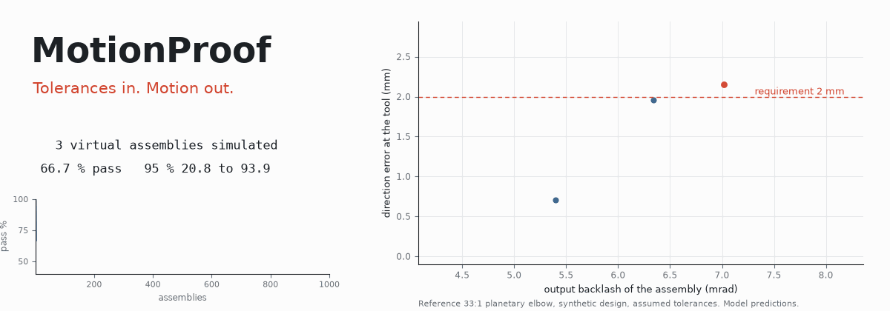
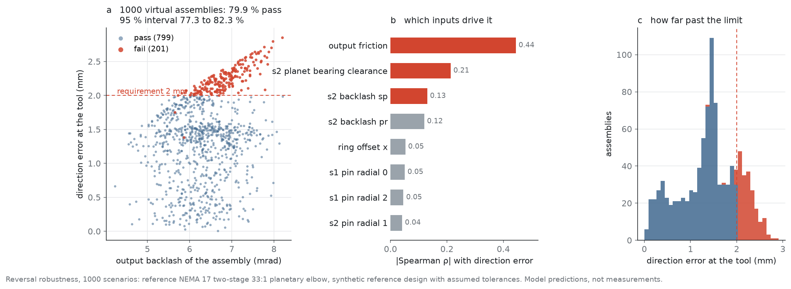
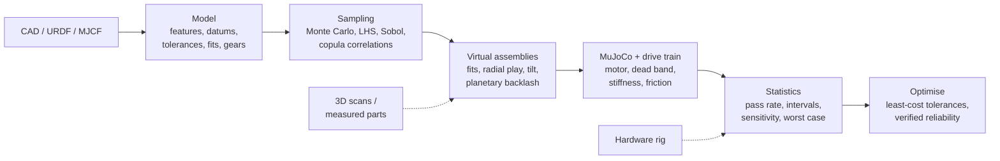

<p align="center">
  
</p>

<p align="center">
  <b>What happens to your mechanism's motion when the parts come off the machine slightly wrong?</b>
</p>

<p align="center">
  <a href="LICENSE"></a>
  
  
  
  
</p>

MotionProof builds **virtual as-manufactured copies** of a CAD assembly from its tolerance
specification, simulates each one on MuJoCo with a drive train that has backlash, stiffness and
friction, and tells you **which copies fail, how often, and which tolerances are to blame**.

| 1 | 2 | 3 | 4 |
|:--|:--|:--|:--|
| **Import** a STEP, STL, URDF or MJCF model | **Specify** limits, distributions and fits | **Simulate** hundreds to thousands of variants | **Rank** the tolerances that drive failures, then find the cheapest set that still passes |

> [!NOTE]
> Results are model predictions, conditional on the geometry, tolerances and drive-train values you
> supply, not a certification. Every value is marked `specified`, `assumed` or `measured`. No
> physical measurement has been made yet; see [verification](docs/verification.md).

## A real run

<p align="center"></p>

The reference elbow (a NEMA 17 motor and a two-stage 33:1 planetary gearbox), 1000 virtual
assemblies reversing the joint:

* **79.9 % pass** (95 % interval 77.3 to 82.3 %); 201 miss a requirement.
* Most failures are a direction error above 2 mm.
* Output friction and the stage 2 planet bearing clearance drive the error most.

## How it works



## The app

<p align="center"></p>

29 screens, a REST API, a CLI and a [Python SDK](docs/python-sdk.md). Dark and light themes.
Accounts keep their own workspaces. [All features](docs/features.md).

## Quick start

Python 3.12 with [`uv`](https://docs.astral.sh/uv/), Node 24 for the web app.

```bash
uv sync
cd frontend && npm ci && npm run build && cd ..
uv run motionproof serve --home workspace
```

Open http://127.0.0.1:8000 (no sign-in on your own computer), create a project, and click **Add
reference design**. Or from the command line: `uv run motionproof reference create demo`.

## Go deeper

| | |
|:--|:--|
| [Features](docs/features.md) | Everything the tool does, by area |
| [Python SDK](docs/python-sdk.md) | The same experiment from Python |
| [Verification](docs/verification.md) | Benchmarks, tests, external validation, what is not proven |
| [Project report](docs/project-report.md) | The whole system in one document |
| [Architecture](docs/architecture.md) | Packages and design decisions |
| [Getting started](docs/getting-started.md) | A guided first session |
| [Development](docs/development.md) · [Contributing](CONTRIBUTING.md) | Lint, types, tests, e2e |
| [Hosting](docs/hosting.md) | Where to run it and how to run it safely |
| [Security](SECURITY.md) · [Changelog](CHANGELOG.md) | Accounts and sessions; release notes |

[MIT licence](LICENSE).
