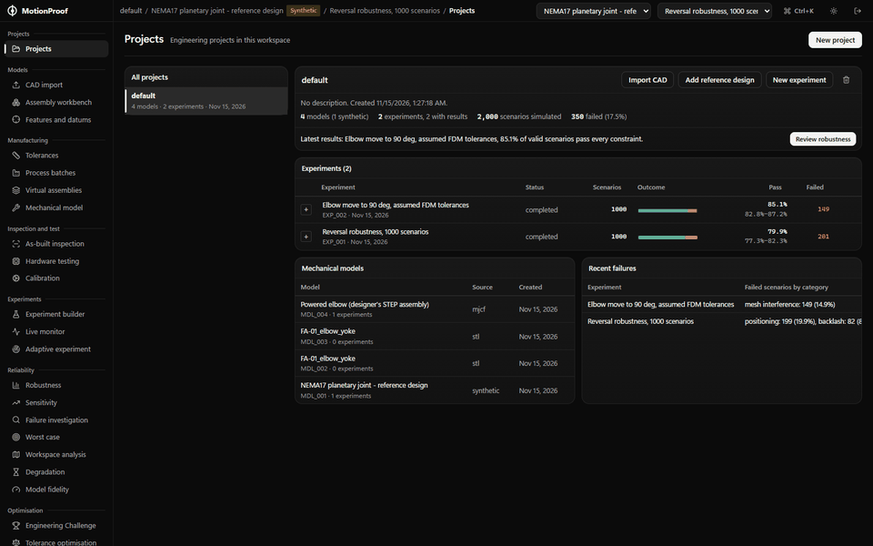
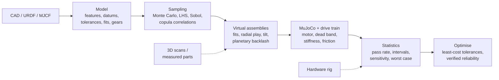
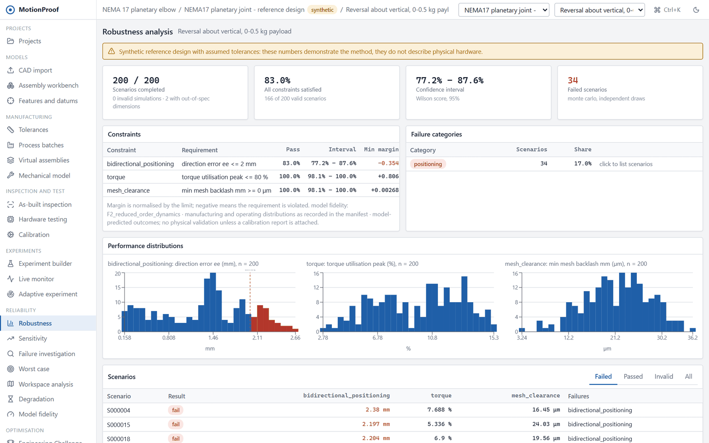
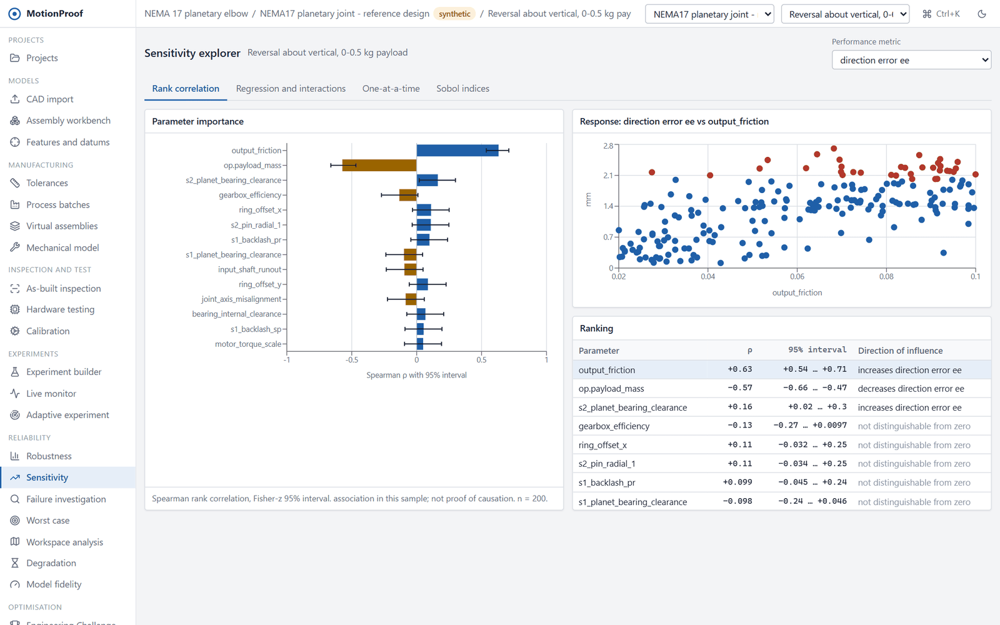
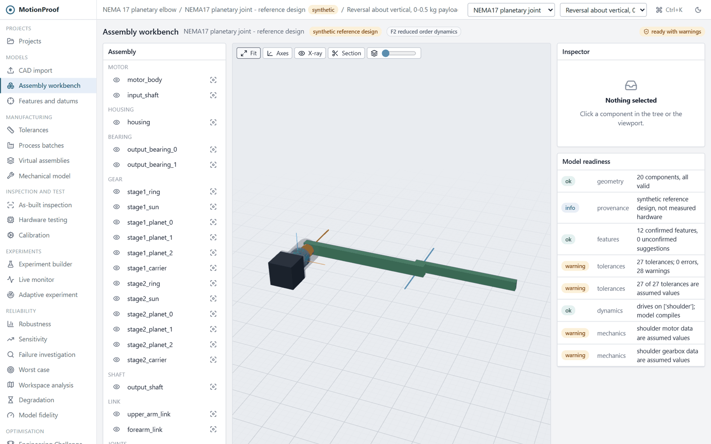
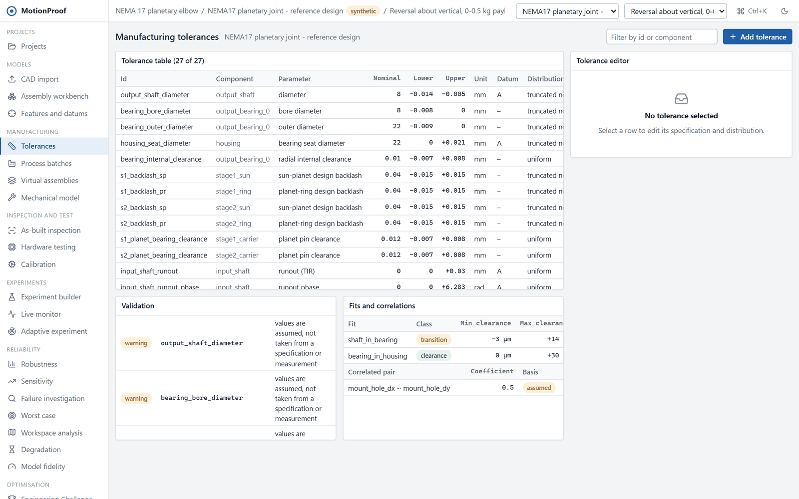
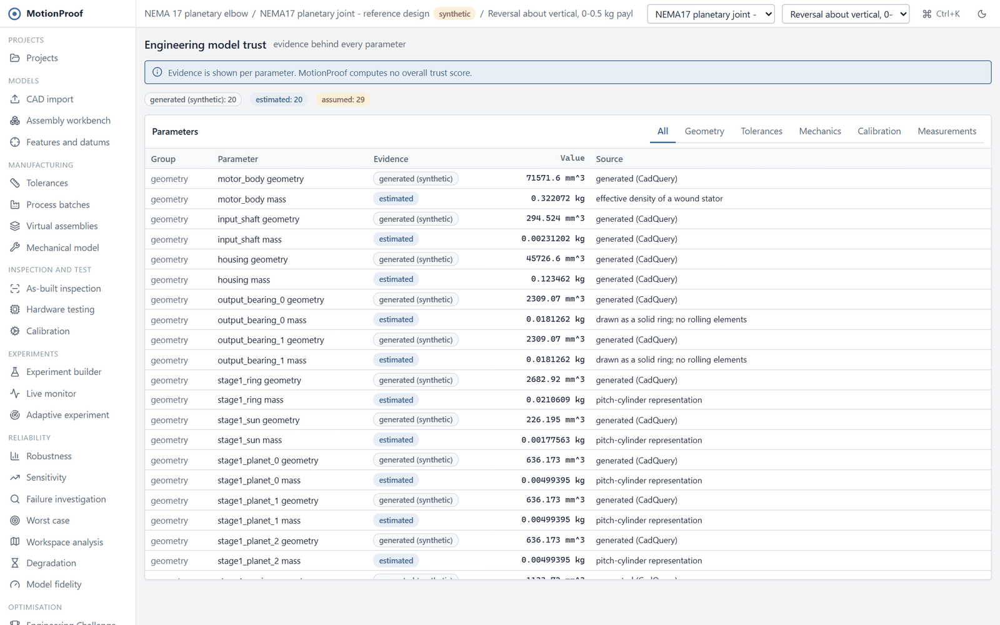
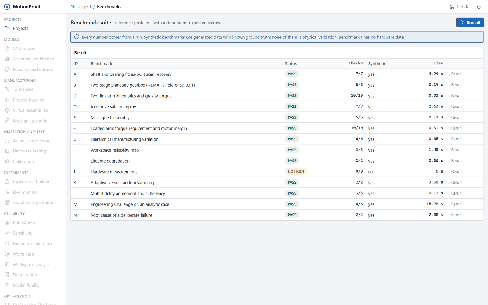

<h1 align="center">MotionProof</h1>

<p align="center">
  <b>Tolerance-to-dynamics engineering lab.</b><br>
  What happens to your mechanism's motion when the parts come off the machine slightly wrong?
</p>

<p align="center">
  <a href="LICENSE"></a>
  
  
  
  
</p>

<p align="center">
  
</p>

MotionProof takes a CAD assembly and its tolerance specification, builds **virtual
as-manufactured copies** of it, simulates each copy doing its job on MuJoCo with a gearbox model
that includes backlash, stiffness and friction, and tells you **which copies fail, how often,
and which tolerances are to blame**. Then it searches for the cheapest tolerance set that still
meets the requirement, and checks the answer on fresh scenarios.

> Results are model predictions, conditional on the geometry, tolerances and drive-train values
> you supply. Nothing here certifies real-world reliability. Every value carries its provenance
> (`specified`, `assumed` or `measured`) and the app shows which is which.

## How it works



The physics in one block: each driven joint has a rotor coupled to the output through a dead
band of width *b* and a torsional spring *k*,

```
gap = θ_rotor + TE(θ_rotor) − θ_output
τ   = k·(gap − clip(gap, −b/2, b/2)) + c·Δω      (a flank can push, never pull)
```

and the backlash *b* is computed per variant from the gear stages:
`((j_sun-planet + j_planet-ring)/2 + c_bearing) / centre_distance`, worst planet wins.

## A look inside

<table>
  <tr>
    <td width="50%"></td>
    <td width="50%"></td>
  </tr>
  <tr>
    <td><b>Robustness.</b> 200 virtual assemblies of a two-stage 33:1 planetary elbow, reversing about the vertical. Pass rate with its confidence interval, the failures in red.</td>
    <td><b>Sensitivity.</b> Which tolerances drive the error, with 95 % intervals and the raw scatter behind each ranking.</td>
  </tr>
  <tr>
    <td></td>
    <td></td>
  </tr>
  <tr>
    <td><b>Assembly workbench.</b> Component tree, 3D view with x-ray and section, and a readiness check that refuses to hide assumed values.</td>
    <td><b>Tolerances.</b> Limits, distributions, datums, fits and correlations, with a validation panel.</td>
  </tr>
  <tr>
    <td></td>
    <td></td>
  </tr>
  <tr>
    <td><b>Model trust.</b> The evidence behind every parameter: generated, estimated, assumed or measured.</td>
    <td><b>Benchmarks.</b> 14 reference problems with independent expected values. J stays NOT RUN until a physical rig exists.</td>
  </tr>
</table>

The screenshots come from the synthetic reference design. Its tolerances are illustrative
assumptions, not anyone's hardware.

## What's in the box

| Area | What you get |
|---|---|
| **Import** | STEP, STL, OBJ, URDF, MJCF; cylinder detection on STEP solids; exact B-rep fit measurement |
| **Tolerances** | six distributions, Gaussian-copula correlation, five sampling designs, Cp/Cpk, stack-ups |
| **Dynamics** | MuJoCo multibody plus motor torque-speed limit, gearbox backlash, stiffness, efficiency and friction |
| **Experiments** | immutable manifests, checkpoint and resume, bit-exact replay of any scenario |
| **Analysis** | Wilson and Clopper-Pearson intervals, Spearman/regression/Sobol sensitivity, worst-case search, root cause by counterfactual rerun |
| **Optimisation** | Engineering Challenge: least-cost tolerances under a verified reliability bound, with a yield (scrap) cost model |
| **As-built** | point-cloud import, cleaning, ICP or datum registration, deviation maps, feature fits |
| **Manufacturing** | hierarchical process variation (batch, setup, tool, part), drift, variance components, measured-dimension import |
| **Reliability** | workspace maps, lifetime degradation, adaptive Gaussian-process sampling, multi-fidelity checks |
| **Hardware** | JSON-lines rig protocol, safety monitor, ESP32 firmware sketch, encoder analysis without the model |
| **Interfaces** | web app (28 screens), REST API (66 routes), CLI (47 commands), Python SDK, PDF/Markdown/JSON/CSV reports |

## Quick start

Python 3.12 with [`uv`](https://docs.astral.sh/uv/), Node 24 for the web app.

```bash
uv sync
```

```bash
cd frontend && npm ci && npm run build && cd ..
```

```bash
uv run motionproof serve --home workspace
```

Open http://127.0.0.1:8000, create a project and click **Add reference design**. Or from the
command line:

```bash
uv run motionproof reference create demo
```

```bash
uv run motionproof doctor
```

## Python SDK

```python
from motionproof import MechanicalModel
from motionproof.experiments import ManufacturingExperiment
from motionproof.uncertainty import Uniform

model = MechanicalModel.load("demo/model.yaml")
experiment = ManufacturingExperiment(
    model=model,
    task={"type": "reversal", "joint": "shoulder", "target": {"shoulder": 1.5708}},
    samples=100,
    seed=42,
)
experiment.add_operating_variation("payload_mass", Uniform(0.0, 0.5))
experiment.add_constraint("lost_motion", "<=", 0.0065)
results = experiment.run()
print(results.failure_estimate)
print(results.sensitivity("lost_motion")[:5])
```

## Trust, but verify

* **Benchmarks.** `uv run python benchmarks/publish.py` regenerates the inputs and raw data,
  runs the suite, and re-checks 57 quantities with
  [`reference_calculations.py`](benchmarks/reference_calculations.py), which uses only NumPy
  and SciPy and never imports MotionProof. Results: [`BENCHMARK_RESULTS.md`](BENCHMARK_RESULTS.md).
* **Tests.** 225 tests, including analytic physics checks, an API contract that no route
  answers 5xx to bad input, and Playwright end-to-end tests against the real backend.
* **Honesty.** [`DEVELOPMENT_STATUS.md`](DEVELOPMENT_STATUS.md) lists what is verified, what is
  not and the known defects. No physical measurement has been made yet. The rig procedure is in
  [`docs/rig-build-and-test.md`](docs/rig-build-and-test.md).

## Development

```bash
uv run ruff check motionproof tests benchmarks
```

```bash
uv run mypy motionproof
```

```bash
uv run pytest
```

```bash
cd frontend && npm run typecheck && npm run build && npm run e2e
```

`npm run e2e` starts its own backend on port 8765 with a fresh workspace. Set
`MP_E2E_CHANNEL=chrome` to use an installed Chrome instead of Playwright's Chromium.

## Documentation

[`PROJECT_REPORT.md`](PROJECT_REPORT.md) explains the whole system in one document. Deeper
reading: [`ARCHITECTURE.md`](ARCHITECTURE.md), [`ENGINEERING_CHALLENGE.md`](ENGINEERING_CHALLENGE.md)
and the [`docs/`](docs) folder (start with `docs/getting-started.md`).

## Licence

[MIT](LICENSE).
