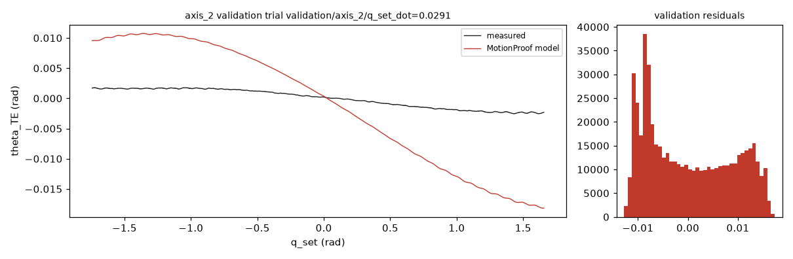
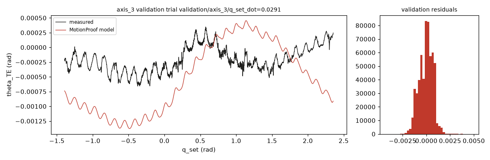

# VALIDATION_001: Gearbox transmission error, Staubli TX2-40 axes 2 and 3

**Status: FAIL** (benchmark X1, protocol `transmission-error`)

- System: Staubli TX2-40 gearboxes on an experimental setup
- Quantity compared: theta_TE (rad), as published, at every published sample
- Baseline: B0: constant transmission error equal to the identification mean, per axis
- MotionProof model: MotionProof TE: c0 + (b/2) sign(q_set_dot) + sum_k [a_k sin(k q_set) + c_k cos(k q_set)], the periodic TE term and dead-band offset of the drive model; orders k: the 30 largest integer orders 1..4000 cycles per joint revolution in the identification spectrum (uniform q grid, step 1e-4 rad)
- Acceptance (pre-registered): per axis: validation RMSE(model) <= 0.5 x validation RMSE(B0) and validation RMSE(model) <= 1.5 x identification RMSE(model); X1 passes only if both axes pass
- Identification: all files in identification/axis_2 and identification/axis_3
- Validation: all files in validation/axis_2 and validation/axis_3 (published split)
- Unused: identification/axis_1 (no validation recordings exist for axis 1)
- Scope: external system; says nothing about the MotionProof reference gearbox or user hardware

### axis_2: FAIL

| Set | Model | RMSE | MAE |
|---|---|---|---|
| identification | model | 0.001592 | 0.001155 |
| identification | baseline | 0.01019 | 0.009063 |
| validation | model | 0.00859 | 0.007636 |
| validation | baseline | 0.001652 | 0.001455 |

RMSE ratio model / baseline: 5.200

### axis_3: FAIL

| Set | Model | RMSE | MAE |
|---|---|---|---|
| identification | model | 0.001133 | 0.0007811 |
| identification | baseline | 0.00138 | 0.0009384 |
| validation | model | 0.0007229 | 0.000578 |
| validation | baseline | 0.0006718 | 0.0004749 |

RMSE ratio model / baseline: 1.076





## Transformations

- none: theta_TE compared at the published samples
- orders chosen from identification spectrum only (uniform q resampling, step 1e-4 rad, Hann window)

## Data

- Dataset: Replication Data for: Transmission Error Compensation for Industrial Robots Using Fourier Series
- Source: https://darus.uni-stuttgart.de/dataset.xhtml?persistentId=doi%3A10.18419%2FDARUS-5760
- Version: 1.0
- Licence: CC BY 4.0
- Citation: C. J. E. Bauer et al., "Replication Data for: Transmission Error Compensation for Industrial Robots Using Fourier Series", DaRUS, V1, 2026, doi:10.18419/DARUS-5760 (CC BY 4.0). Supplement to C. Bauer, S. Nowinski, V. Kamm, L. Steinle, A. Lechler, A. Verl, "Transmission Error Compensation for Industrial Robots Using Fourier Series", MHI 2026.
- Files used: 104 (checksums in record.json)

## Reproduce

```bash
motionproof external validate transmission-error
```

Recorded 2026-11-16T10:50:15+00:00 with MotionProof 0.3.0, adapter 1.0.0, Windows-11-10.0.26300-SP0.
