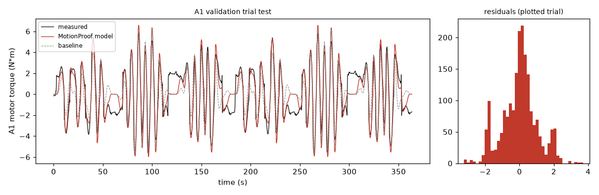
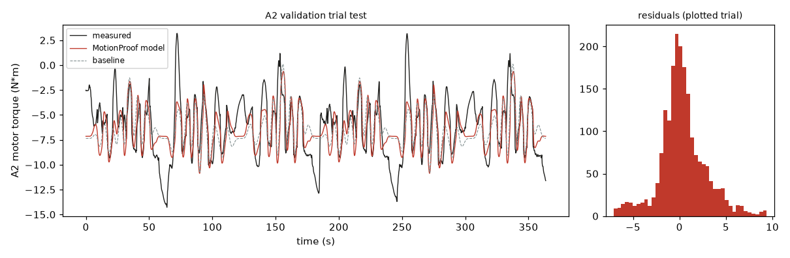
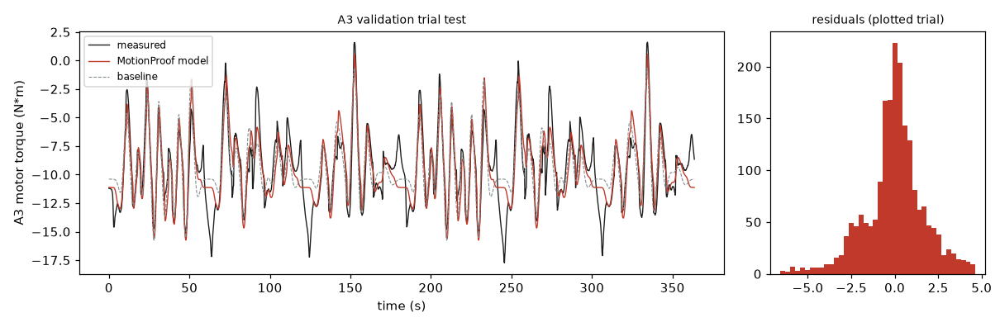
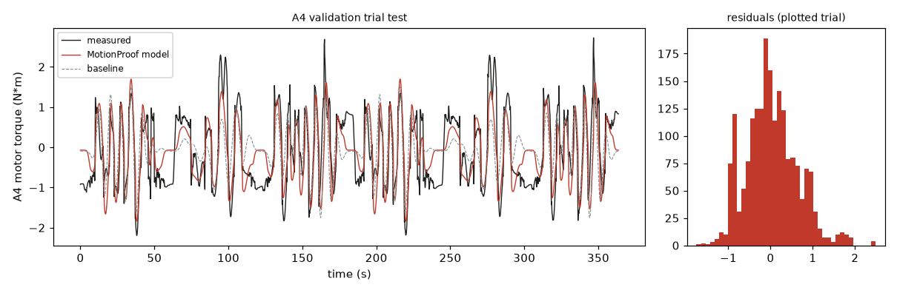
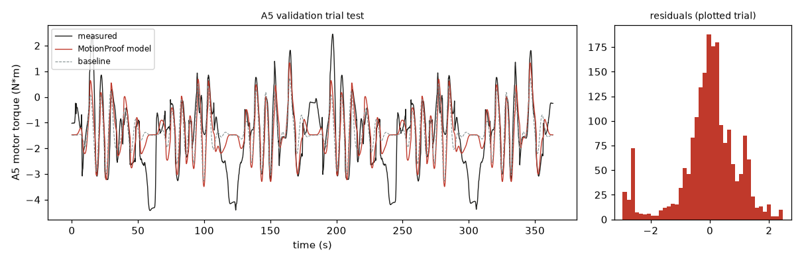
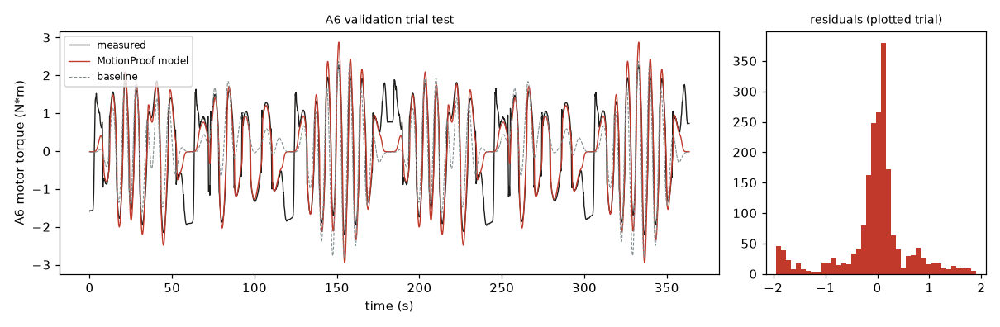

# VALIDATION_002: Inverse dynamics per axis, KUKA KR300 R2500 ultra SE

**Status: FAIL** (benchmark X4, protocol `kuka-inverse`)

- System: KUKA KR300 R2500 ultra SE (6 axes)
- Quantity compared: motor torque per axis (N*m), benchmark test set
- Baseline: B0 per axis: tau = J ddq + g1 sin q + g2 cos q + tau0
- MotionProof model: MotionProof single-joint drive model per axis: B0 + c dq + Fc tanh(dq / 0.02 rad/s). Joint coupling, pose-dependent inertia and the axis-2 hydraulic counterbalance are NOT modelled
- Acceptance (pre-registered): every axis: test RMSE(model) <= 0.8 x test RMSE(B0)
- Identification: benchmark training set (inverse identification, without raw data)
- Validation: benchmark test set
- Unused: raw high-rate runs (excluded by the benchmark for comparability)
- Scope: external system; says nothing about the MotionProof reference gearbox or user hardware

### A1: PASS

| Set | Model | RMSE | MAE | max abs | mean error | NRMSE | R^2 |
|---|---|---|---|---|---|---|---|
| identification | model | 1.012 | 0.7838 | 4.441 | 8.444e-16 | 0.3592 | 0.871 |
| validation | model | 1.033 | 0.7729 | 3.723 | 0.02018 | 0.4012 | 0.8391 |
| identification | baseline | 1.589 | 1.394 | 4.935 | -5.117e-15 | 0.5642 | 0.6817 |
| validation | baseline | 1.451 | 1.266 | 3.453 | -0.0413 | 0.5634 | 0.6826 |

RMSE ratio model / baseline: 0.712

### A2: FAIL

| Set | Model | RMSE | MAE | max abs | mean error | NRMSE | R^2 |
|---|---|---|---|---|---|---|---|
| identification | model | 2.795 | 2.019 | 13.51 | 2.308e-13 | 0.8101 | 0.3438 |
| validation | model | 2.518 | 1.792 | 9.405 | 0.3064 | 0.8245 | 0.3202 |
| identification | baseline | 2.949 | 2.315 | 13.12 | -1.88e-14 | 0.8545 | 0.2698 |
| validation | baseline | 2.714 | 2.1 | 8.514 | 0.2659 | 0.8888 | 0.21 |

RMSE ratio model / baseline: 0.928

### A3: FAIL

| Set | Model | RMSE | MAE | max abs | mean error | NRMSE | R^2 |
|---|---|---|---|---|---|---|---|
| identification | model | 1.852 | 1.315 | 8.741 | 1.103e-14 | 0.527 | 0.7222 |
| validation | model | 1.704 | 1.238 | 6.617 | -0.006638 | 0.527 | 0.7223 |
| identification | baseline | 2.218 | 1.751 | 9.473 | 8.094e-15 | 0.6311 | 0.6017 |
| validation | baseline | 2.001 | 1.617 | 7.363 | -0.03704 | 0.6188 | 0.6171 |

RMSE ratio model / baseline: 0.852

### A4: PASS

| Set | Model | RMSE | MAE | max abs | mean error | NRMSE | R^2 |
|---|---|---|---|---|---|---|---|
| identification | model | 0.6369 | 0.4931 | 3.157 | 5.558e-16 | 0.6475 | 0.5807 |
| validation | model | 0.6157 | 0.4793 | 2.713 | 0.0265 | 0.6611 | 0.5629 |
| identification | baseline | 0.7985 | 0.6739 | 2.933 | 5.146e-16 | 0.8119 | 0.3409 |
| validation | baseline | 0.7734 | 0.6465 | 2.555 | -0.03403 | 0.8305 | 0.3103 |

RMSE ratio model / baseline: 0.796

### A5: FAIL

| Set | Model | RMSE | MAE | max abs | mean error | NRMSE | R^2 |
|---|---|---|---|---|---|---|---|
| identification | model | 0.9372 | 0.7102 | 3.183 | 4.833e-15 | 0.6915 | 0.5219 |
| validation | model | 1.008 | 0.709 | 2.95 | -0.04737 | 0.7462 | 0.4431 |
| identification | baseline | 1.075 | 0.8573 | 3.415 | 4.728e-15 | 0.7931 | 0.371 |
| validation | baseline | 1.109 | 0.8389 | 3.133 | -0.08684 | 0.821 | 0.326 |

RMSE ratio model / baseline: 0.909

### A6: PASS

| Set | Model | RMSE | MAE | max abs | mean error | NRMSE | R^2 |
|---|---|---|---|---|---|---|---|
| identification | model | 0.6985 | 0.4285 | 2.095 | 7.882e-16 | 0.5182 | 0.7315 |
| validation | model | 0.6532 | 0.4093 | 1.945 | -0.03055 | 0.5182 | 0.7315 |
| identification | baseline | 1.02 | 0.8649 | 2.119 | 1.194e-16 | 0.7569 | 0.4271 |
| validation | baseline | 0.945 | 0.7964 | 2.051 | -0.09844 | 0.7497 | 0.438 |

RMSE ratio model / baseline: 0.691













## Transformations

- deg, deg/s, deg/s^2 converted to rad, rad/s, rad/s^2
- benchmark's filtered, down-sampled data used unchanged

## Data

- Dataset: Dataset and Baseline for an Industrial Robot Identification Benchmark
- Source: https://www.nonlinearbenchmark.org/benchmarks/industrial-robot
- Version: 2022 release (files dated 17-Jan-2022)
- Licence: as stated by the publisher at doi:10.26204/data/5 (benchmark data for research use with citation)
- Citation: J. Weigand, J. Goetz, J. Ulmen, M. Ruskowski, "Dataset and Baseline for an Industrial Robot Identification Benchmark", 6th Workshop on Nonlinear System Identification Benchmarks, Leuven, 2022, urn:nbn:de:hbz:386-kluedo-67317; data doi:10.26204/data/5.
- Files used: 1 (checksums in record.json)

## Reproduce

```bash
motionproof external validate kuka-inverse
```

Recorded 2026-11-16T10:50:20+00:00 with MotionProof 0.3.0, adapter 1.0.0, Windows-11-10.0.26300-SP0.
