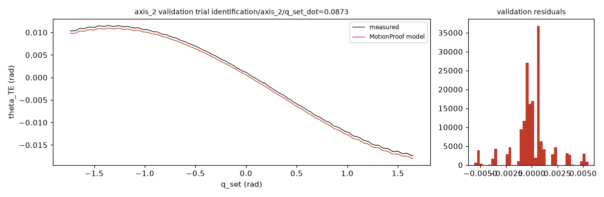
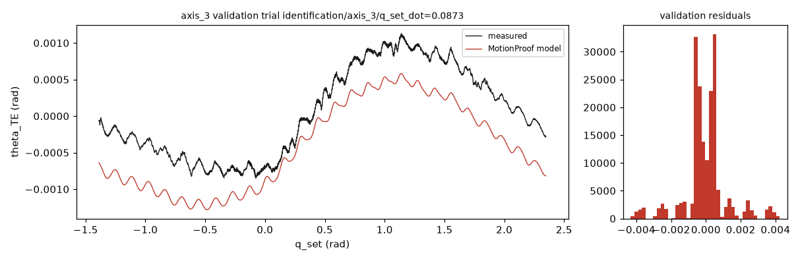

# VALIDATION_004: Gearbox transmission error, Staubli TX2-40 axes 2 and 3 (speed holdout)

**Status: FAIL** (benchmark X1, protocol `transmission-error-v3`)

- System: Staubli TX2-40 gearboxes on an experimental setup
- Quantity compared: theta_TE (rad) without compensation, at every published sample
- Baseline: B0: constant transmission error equal to the identification mean, per axis
- MotionProof model: as transmission-error-v2 (orders with >= 2 periods over the shortest identification recording, 30 largest up to 4000)
- Acceptance (pre-registered): per axis: validation RMSE(model) <= 0.5 x validation RMSE(B0) and validation RMSE(model) <= 1.5 x identification RMSE(model); X1 passes only if both axes pass (unchanged)
- Identification: identification/axis_k files whose velocity setpoint has an even rank (0, 2, 4, ...) when the setpoints of each sign are sorted by magnitude
- Validation: identification/axis_k files with odd rank (whole recordings, never mixed)
- Unused: validation/ folder: residual TE with the authors' compensation active (a different quantity); identification/axis_1
- Scope: external system; says nothing about the MotionProof reference gearbox or user hardware

### axis_2: PASS

| Set | Model | RMSE | MAE |
|---|---|---|---|
| identification | model | 0.001511 | 0.001018 |
| identification | baseline | 0.01016 | 0.009056 |
| validation | model | 0.001787 | 0.001169 |
| validation | baseline | 0.01024 | 0.009077 |

RMSE ratio model / baseline: 0.175

### axis_3: FAIL

| Set | Model | RMSE | MAE |
|---|---|---|---|
| identification | model | 0.00107 | 0.000671 |
| identification | baseline | 0.001294 | 0.0008689 |
| validation | model | 0.00127 | 0.0008438 |
| validation | baseline | 0.001545 | 0.001086 |

RMSE ratio model / baseline: 0.822





## Transformations

- none: theta_TE compared at the published samples
- orders chosen from identification spectrum only (uniform q resampling, step 1e-4 rad, Hann window)

## Data

- Dataset: Replication Data for: Transmission Error Compensation for Industrial Robots Using Fourier Series
- Source: https://darus.uni-stuttgart.de/dataset.xhtml?persistentId=doi%3A10.18419%2FDARUS-5760
- Version: 1.0
- Licence: CC BY 4.0
- Citation: C. J. E. Bauer et al., "Replication Data for: Transmission Error Compensation for Industrial Robots Using Fourier Series", DaRUS, V1, 2026, doi:10.18419/DARUS-5760 (CC BY 4.0). Supplement to C. Bauer, S. Nowinski, V. Kamm, L. Steinle, A. Lechler, A. Verl, "Transmission Error Compensation for Industrial Robots Using Fourier Series", MHI 2026.
- Files used: 52 (checksums in record.json)

## Reproduce

```bash
motionproof external validate transmission-error-v3
```

Recorded 2026-11-16T10:52:32+00:00 with MotionProof 0.3.0, adapter 1.0.0, Windows-11-10.0.26300-SP0.
