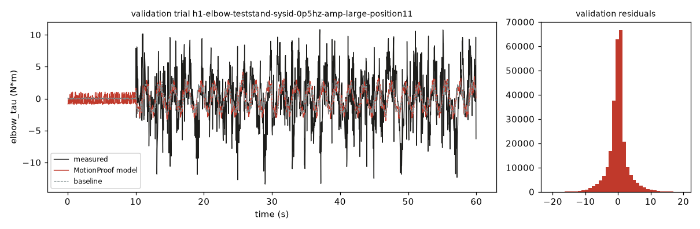

# VALIDATION_009: Joint friction and dynamics, Unitree H1 elbow test stand

**Status: FAIL** (benchmark X2, protocol `h1-friction`)

- System: Unitree H1 elbow actuator on the Anchor-Lab test stand
- Quantity compared: elbow_tau (actuator torque estimate, N*m), on a uniform 2 ms grid
- Baseline: B0: rigid joint without friction, tau = J ddq + g1 sin q + g2 cos q + tau0
- MotionProof model: MotionProof joint friction: B0 + c dq + Fc tanh(dq / 0.02 rad/s) (viscous damping plus smoothed Coulomb friction, as the drive model's damping and frictionloss)
- Acceptance (pre-registered): validation RMSE(model) <= 0.8 x validation RMSE(B0) and validation NRMSE(model) <= 0.35
- Identification: 36 sine trials (0.5/1.0/1.5 Hz x small/medium/large) at stand positions 8, 9 and 10
- Validation: the 12 sine trials at stand position 11 (whole trials, never mixed)
- Unused: all other Anchor-Lab trials
- Scope: external system; says nothing about the MotionProof reference gearbox or user hardware

### Metrics

| Set | Model | RMSE | MAE | max abs | mean error | NRMSE | R^2 |
|---|---|---|---|---|---|---|---|
| identification | model | 3.323 | 2.186 | 22.69 | -2.913e-15 | 0.9137 | 0.1652 |
| validation | model | 3.027 | 1.975 | 21.55 | 0.01367 | 0.877 | 0.2309 |
| identification | baseline | 3.373 | 2.12 | 22.53 | -3.987e-15 | 0.9273 | 0.1401 |
| validation | baseline | 3.057 | 1.888 | 21.42 | 0.003569 | 0.8856 | 0.2157 |

RMSE ratio model / baseline (validation): 0.990

## Fitted parameters

```json
{
 "model": {
  "parameters": {
   "J": 0.038765627568572804,
   "g1": -1.0475509418801767,
   "g2": 1.6339080979201535,
   "tau0": -0.30825019901791323,
   "c_viscous": -0.3240687642475893,
   "F_coulomb": 0.9194142281552117
  },
  "standard_errors": {
   "J": 0.00021461635653256825,
   "g1": 0.029245783508501884,
   "g2": 0.02925189650573561,
   "tau0": 0.0366017974727613,
   "c_viscous": 0.0023721597460936257,
   "F_coulomb": 0.006013774305151547
  },
  "condition_number_scaled": 39.24856293244835,
  "highly_correlated_pairs": [],
  "note": "standard errors assume independent residuals and are optimistic for time series"
 },
 "baseline": {
  "parameters": {
   "J": 0.03852840210799276,
   "g1": -1.3494566530039602,
   "g2": 1.3427423422051399,
   "tau0": 0.020725481288316288
  },
  "standard_errors": {
   "J": 0.00021780610785689027,
   "g1": 0.02961364587392583,
   "g2": 0.029623573153768228,
   "tau0": 0.03708262438084325
  },
  "condition_number_scaled": 39.1655093114147,
  "highly_correlated_pairs": [],
  "note": "standard errors assume independent residuals and are optimistic for time series"
 }
}
```



## Transformations

- q, dq, tau linearly interpolated onto a common uniform 2 ms grid inside the shared time span (no extrapolation)
- ddq: Savitzky-Golay derivative of dq (21 samples, cubic)
- 25 samples trimmed at each end (derivative edge effects)

## Data

- Dataset: Anchor-Lab: sim-to-real robot telemetry (NVIDIA Robotics)
- Source: https://huggingface.co/datasets/nvidia/Anchor-Lab
- Version: v1.0 (Hugging Face revision 647edd5787cd764cdc041103ad282dc59214d919)
- Licence: Apache-2.0
- Citation: NVIDIA Robotics, "Anchor-Lab Dataset", v1.0, Hugging Face, June 2026, https://huggingface.co/datasets/nvidia/Anchor-Lab (Apache License 2.0).
- Files used: 36 (checksums in record.json)

## Reproduce

```bash
motionproof external validate h1-friction
```

Recorded 2026-11-16T11:04:22+00:00 with MotionProof 0.3.0, adapter 1.0.0, Windows-11-10.0.26300-SP0.
