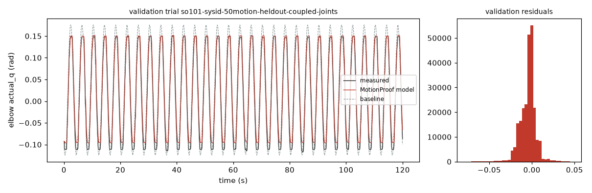

# VALIDATION_010: Simulated joint response to the recorded command, SO-101 elbow servo

**Status: PASS** (benchmark X3, protocol `so101-tracking`)

- System: SO-101 arm, elbow joint (Feetech servo)
- Quantity compared: elbow/actual_q (rad) at its own sample instants
- Baseline: B0: actual = command held between samples (zero-order hold) + constant offset fitted on identification
- MotionProof model: MotionProof drive response: second-order position loop (wn, zeta) with velocity limit vmax driving the joint through a dead band b (the drive model's backlash), plus offset; simulated at 1 ms from the recorded command
- Acceptance (pre-registered): pooled validation RMSE(model) <= 0.6 x pooled validation RMSE(B0)
- Identification: trial so101-sysid-50motion-train-single-joint-elbow
- Validation: every heldout trial in which the elbow command spans >= 0.1 rad
- Unused: heldout trials in which the elbow command spans < 0.1 rad (elbow not excited); all other train trials
- Scope: external system; says nothing about the MotionProof reference gearbox or user hardware

### Metrics

| Set | Model | RMSE | MAE | max abs | mean error | NRMSE | R^2 |
|---|---|---|---|---|---|---|---|
| validation | model | 0.01019 | 0.007129 | 0.08121 | -0.004512 | 0.09423 | 0.9911 |
| validation | baseline | 0.03209 | 0.0289 | 0.1333 | -0.002131 | 0.2968 | 0.9119 |

RMSE ratio model / baseline (validation): 0.317

## Fitted parameters

```json
{
 "parameters": {
  "wn": 16.768689393808014,
  "zeta": 0.390464085547711,
  "vmax": 11.592419610848353,
  "deadband": 0.05585596976918293,
  "offset": 0.027262113592770088
 },
 "standard_errors": {
  "wn": 0.16823098457298094,
  "zeta": 0.004579077163220628,
  "vmax": 0.0,
  "deadband": 9.908697115574936e-05,
  "offset": 3.0425864125948064e-05
 },
 "at_bound": [],
 "not_identifiable": [
  "vmax"
 ],
 "identification_rmse": 0.005291682402812961
}
```



## Transformations

- command held constant between its samples (zero-order hold)
- simulation at 1 ms, linearly interpolated to the actual_q sample instants
- only samples inside the command time span

## Data

- Dataset: Anchor-Lab: sim-to-real robot telemetry (NVIDIA Robotics)
- Source: https://huggingface.co/datasets/nvidia/Anchor-Lab
- Version: v1.0 (Hugging Face revision 647edd5787cd764cdc041103ad282dc59214d919)
- Licence: Apache-2.0
- Citation: NVIDIA Robotics, "Anchor-Lab Dataset", v1.0, Hugging Face, June 2026, https://huggingface.co/datasets/nvidia/Anchor-Lab (Apache License 2.0).
- Files used: 9 (checksums in record.json)

## Reproduce

```bash
motionproof external validate so101-tracking
```

Recorded 2026-11-16T11:07:23+00:00 with MotionProof 0.3.0, adapter 1.0.0, Windows-11-10.0.26300-SP0.
