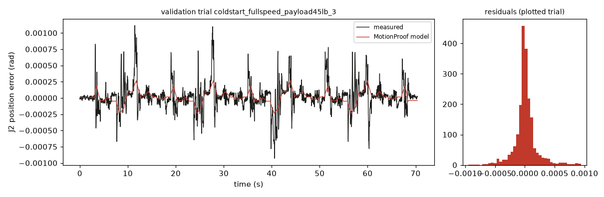

# VALIDATION_012: Joint position error under speed, payload and temperature, UR5

**Status: FAIL** (benchmark X5, protocol `nist-tracking`)

- System: Universal Robots UR5
- Quantity compared: joint position error e = target q - actual q (rad), controller data
- Baseline: B0 per joint: constant error equal to the identification mean
- MotionProof model: MotionProof static drive deflection per joint: e = e0 + tau_target / k + (b/2) sign(dq_target) + lag x dq_target (compliance, dead band and a velocity lag of the position loop)
- Acceptance (pre-registered): every joint J1..J6: validation RMSE(model) <= 0.8 x validation RMSE(B0)
- Identification: repeats 1 and 2 of every condition
- Validation: repeat 3 of every condition
- Unused: tool pose, TCP force
- Scope: external system; says nothing about the MotionProof reference gearbox or user hardware

### J1: PASS

| Set | Model | RMSE | MAE | max abs | mean error | NRMSE | R^2 |
|---|---|---|---|---|---|---|---|
| validation | model | 0.0001252 | 7.982e-05 | 0.00139 | -3.235e-06 | 0.7315 | 0.4649 |
| validation | baseline | 0.0001712 | 9.988e-05 | 0.001839 | -2.91e-06 | 1 | -0.0002888 |

RMSE ratio model / baseline: 0.731

### J2: FAIL

| Set | Model | RMSE | MAE | max abs | mean error | NRMSE | R^2 |
|---|---|---|---|---|---|---|---|
| validation | model | 0.0001592 | 0.0001019 | 0.001184 | -1.121e-06 | 0.9204 | 0.1528 |
| validation | baseline | 0.000173 | 0.0001078 | 0.001329 | -2.484e-06 | 1 | -0.0002062 |

RMSE ratio model / baseline: 0.920

### J3: FAIL

| Set | Model | RMSE | MAE | max abs | mean error | NRMSE | R^2 |
|---|---|---|---|---|---|---|---|
| validation | model | 0.000115 | 7.987e-05 | 0.0009439 | 4.024e-07 | 0.8889 | 0.2098 |
| validation | baseline | 0.0001294 | 8.395e-05 | 0.001228 | -9.091e-08 | 1 | -4.937e-07 |

RMSE ratio model / baseline: 0.889

### J4: FAIL

| Set | Model | RMSE | MAE | max abs | mean error | NRMSE | R^2 |
|---|---|---|---|---|---|---|---|
| validation | model | 0.0001676 | 0.0001178 | 0.001409 | 2.381e-06 | 0.9089 | 0.1738 |
| validation | baseline | 0.0001844 | 0.0001252 | 0.001471 | 2.405e-06 | 1 | -0.0001702 |

RMSE ratio model / baseline: 0.909

### J5: FAIL

| Set | Model | RMSE | MAE | max abs | mean error | NRMSE | R^2 |
|---|---|---|---|---|---|---|---|
| validation | model | 0.0001246 | 8.604e-05 | 0.000693 | -6.38e-07 | 0.994 | 0.01196 |
| validation | baseline | 0.0001253 | 8.698e-05 | 0.0006785 | -4.844e-07 | 1 | -1.494e-05 |

RMSE ratio model / baseline: 0.994

### J6: FAIL

| Set | Model | RMSE | MAE | max abs | mean error | NRMSE | R^2 |
|---|---|---|---|---|---|---|---|
| validation | model | 4.565e-05 | 3.672e-05 | 0.0002502 | 6.24e-06 | 1.005 | -0.009275 |
| validation | baseline | 4.585e-05 | 3.708e-05 | 0.000258 | 6.125e-06 | 1.009 | -0.01817 |

RMSE ratio model / baseline: 0.996



## Transformations

- joint angles deg to rad (unit inferred from values)
- error = target - actual at the same controller sample

## Limitations

- controller-reported actual position, not an external measurement of the joint output
- this is servo tracking error during motion, not TCP accuracy

## Data

- Dataset: Degradation Measurement of Robot Arm Position Accuracy
- Source: https://www.nist.gov/el/intelligent-systems-division-73500/degradation-measurement-robot-arm-position-accuracy
- Version: dataset last updated 2018-09-07
- Licence: NIST licence statement (linked from the data.gov record): https://www.nist.gov/open/license
- Citation: G. Qiao, NIST, "Degradation Measurement of Robot Arm Position Accuracy", 2018, doi:10.18434/M31962. Related: G. Qiao, B. A. Weiss, J. Manuf. Syst. 48 (2018), doi:10.1016/j.jmsy.2018.04.004.
- Files used: 18 (checksums in record.json)

## Reproduce

```bash
motionproof external validate nist-tracking
```

Recorded 2026-11-16T11:07:43+00:00 with MotionProof 0.3.0, adapter 1.0.0, Windows-11-10.0.26300-SP0.
